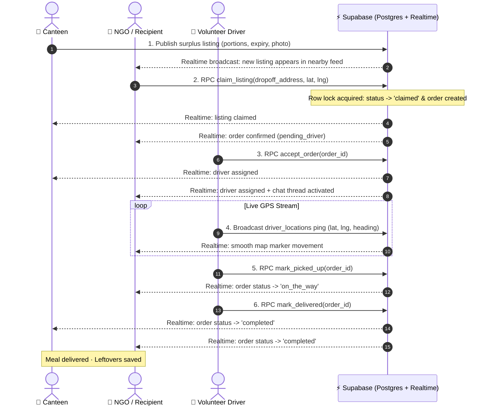
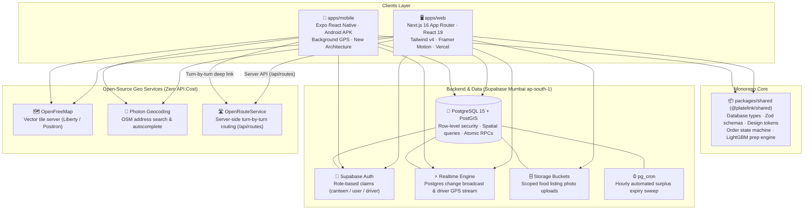
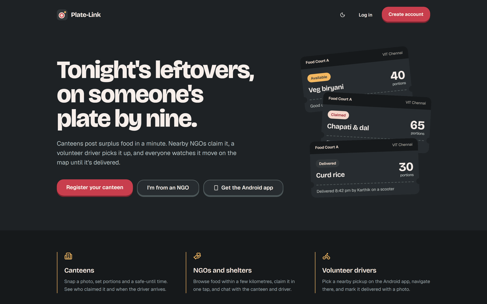
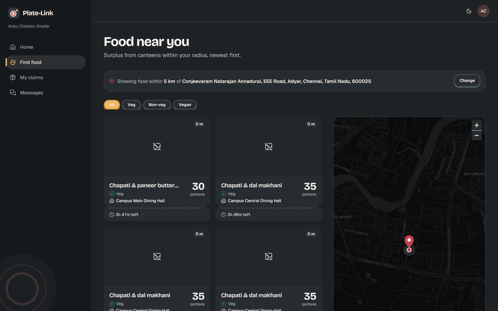
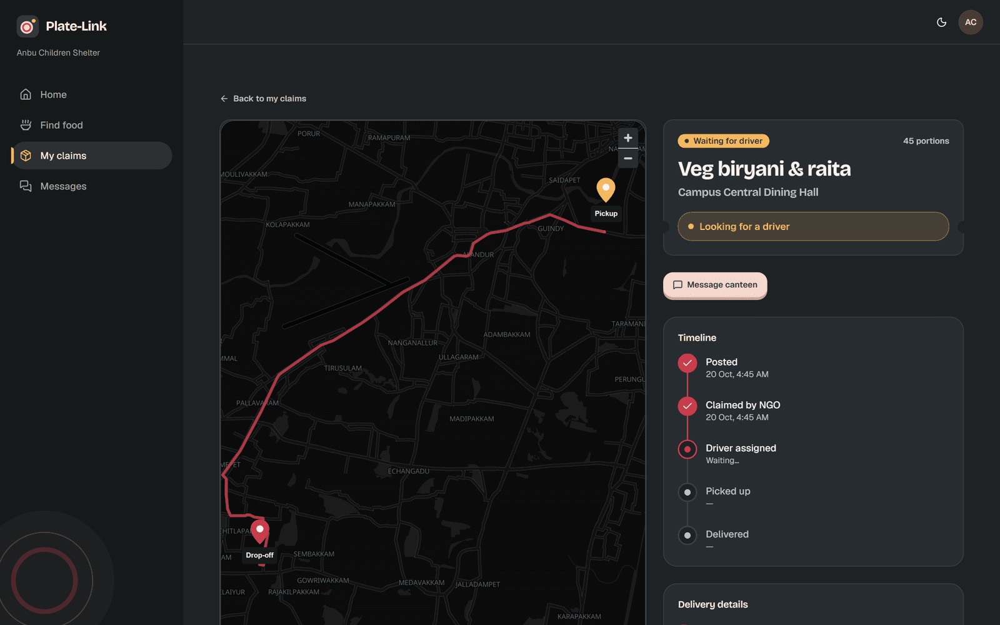
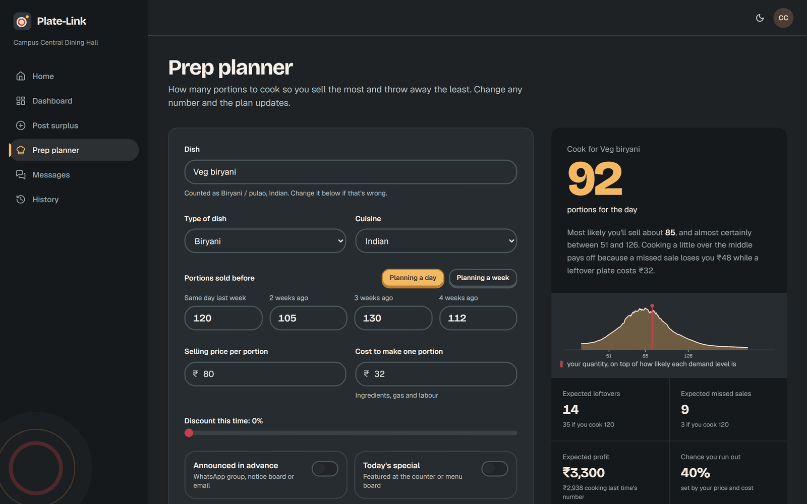

<p align="center">
  <a href="https://github.com/thejynxx/plate-link">
    
  </a>
</p>

<p align="center">
  <strong>Tonight's leftovers, on someone's plate by nine.</strong><br/>
  Real-time canteen food-surplus redistribution: canteens post surplus, NGOs claim it, volunteer drivers deliver it, everyone watches it live.
</p>

<p align="center">
  <a href="https://nextjs.org"></a>
  <a href="https://react.dev"></a>
  <a href="https://www.typescriptlang.org"></a>
  <a href="https://supabase.com"></a>
  <a href="https://postgis.net"></a>
  <a href="https://maplibre.org"></a>
  <a href="https://expo.dev"></a>
  <a href="https://tailwindcss.com"></a>
  <a href="https://lightgbm.readthedocs.io"></a>
  <a href="LICENSE"></a>
  
</p>

<p align="center">
  <a href="#what-it-does">What it does</a> •
  <a href="#features">Features</a> •
  <a href="#how-a-donation-flows">How a donation flows</a> •
  <a href="#architecture">Architecture</a> •
  <a href="#prep-planner-ml">Prep planner (ML)</a> •
  <a href="#tech-stack">Tech stack</a> •
  <a href="#getting-started">Getting started</a> •
  <a href="#roadmap">Roadmap</a>
</p>

<p align="center">
  
</p>

## What it does

<table width="100%">
  <thead>
    <tr>
      <th width="33.3%" align="center">🍲 Canteens & Kitchens</th>
      <th width="33.3%" align="center">🏢 NGOs & Recipients</th>
      <th width="33.3%" align="center">🛵 Volunteer Drivers</th>
    </tr>
  </thead>
  <tbody>
    <tr>
      <td align="left">
        <strong>Post batch surplus in 30 seconds:</strong> Upload a photo, set portion counts, dietary tags, and auto-expiry presets.<br/>
        <strong>Cook smarter with ML:</strong> Client-side LightGBM prep planner forecasts optimal batch sizes to eliminate waste before cooking.
      </td>
      <td align="left">
        <strong>Discover food near you:</strong> Browse active surplus on an interactive MapLibre feed filtered by distance and food preference.<br/>
        <strong>Claim instantly:</strong> Single-click claim locks portions atomically via Postgres RPC and routes delivery to your drop-off address.
      </td>
      <td align="left">
        <strong>Turn-by-turn navigation:</strong> Accept deliveries on Android, pick up food, and follow optimized routes with zero API fees.<br/>
        <strong>Stream live telemetry:</strong> Low-latency GPS pings keep both canteen and recipient updated in real time until drop-off.
      </td>
    </tr>
  </tbody>
</table>

<p align="center">
  
</p>

## Features

| Feature | Description |
| :--- | :--- |
| **🛰️ Live GPS tracking** | Driver location pings stream directly via Supabase Realtime channels with smooth MapLibre interpolation, showing recipients exactly when food arrives. |
| **🔒 Claim state machine** | Concurrency-safe Postgres RPCs (`claim_listing`, `accept_order`, `mark_picked_up`, `mark_delivered`) utilize row-level locks to prevent double claims and race conditions. |
| **💬 Realtime order chat** | Automatic thread creation connecting canteen, recipient, and assigned driver with instant unread badge counters. |
| **🔍 Dish autocomplete** | Fast, client-side fuzzy matching across a curated catalog of hundreds of regional mess and canteen dishes. |
| **🧠 ML prep planner** | Browser-side LightGBM quantile model ($P_{10}$–$P_{90}$) paired with Newsvendor critical ratio optimization to prescribe cost-minimizing prep portions. |
| **🗺️ Zero-cost OSM maps** | Fully open-source mapping stack: MapLibre GL, OpenFreeMap vector tiles, Photon geocoding, and OpenRouteService routing with no Google Maps API fees. |
| **🛡️ Role-based RLS** | Robust PostgreSQL Row Level Security enforcing strict data boundaries across `canteen`, `user` (recipient), and `driver` roles. |
| **📱 Native Android app** | Expo React Native app (`apps/mobile`) for on-the-road drivers and recipients, featuring background location broadcasts and turn-by-turn deep links. |

<p align="center">
  
</p>

## How a donation flows

Every surplus ticket transitions through a coordinated state machine. Status updates broadcast across PostgreSQL Realtime subscriptions to keep all three parties synchronized without page reloads.



<p align="center">
  
</p>

## Architecture

Plate-Link pairs a Next.js 16 App Router web client with an Expo mobile application, unified by a shared core package (`@platelink/shared`) and a zero-cost open-source infrastructure.



<p align="center">
  
</p>

## Prep planner (ML)

Overproduction in canteens is an economic optimization problem: cooking too much creates food waste; cooking too little leads to disappointed diners.

The Plate-Link Prep Planner solves this using **LightGBM quantile regression** ($P_{10}, P_{25}, P_{50}, P_{75}, P_{90}$) combined with the classical **Newsvendor Critical Fractile**:

$$\tau^* = \frac{p - c}{p} = 1 - \frac{c}{p}$$

For a representative 40% food cost share ($c/p = 0.40$), the optimal fractile is $\tau^* = 0.60$. The model interpolates the exact portions to cook directly in the browser via pure TypeScript (`@platelink/shared/prep-model`), trained on 456,548 real kitchen orders.

### Empirical Validation Results (`ml/reports/metrics.json`)

Evaluated on **28,535 test rows** across weeks 136–145:

| Metric | Naive Baseline (Cook Last Week) | 4-Week Moving Average | Plate-Link LightGBM Model | Improvement |
| :--- | :---: | :---: | :---: | :---: |
| **Point Accuracy (RMSLE)** | 0.6457 | 0.6019 | **0.4923** | **+23.8% accuracy** |
| **Food Leftover Rate** | 17.5% | 19.0% | **15.3%** | **-10.7% waste reduction** |
| **Diner Fill Rate** | 83.7% | 84.6% | **87.9%** | **+4.2% availability** |
| **Kitchen Profit Uplift** | ₹868.97M | ₹849.49M | **₹949.51M** | **+9.3% profit uplift** |

*Trained with LightGBM in Python (`ml/train_prep_model.py`); weights serialized to JSON and loaded in zero-latency client code.*

<p align="center">
  
</p>

## Screenshots

<!-- Drop real PNG screenshots in docs/screenshots/ to replace placeholders:
     docs/screenshots/landing.png
     docs/screenshots/feed-map.png
     docs/screenshots/tracking.png
     docs/screenshots/planner.png -->

<table width="100%">
  <thead>
    <tr>
      <th width="50%" align="center">Role Home &amp; Ticket Dashboard</th>
      <th width="50%" align="center">Recipient Feed &amp; MapLibre Map</th>
    </tr>
  </thead>
  <tbody>
    <tr>
      <td align="center">
        
      </td>
      <td align="center">
        
      </td>
    </tr>
    <tr>
      <th align="center">Live GPS Order Tracking</th>
      <th align="center">ML Prep Planner &amp; Waste Minimizer</th>
    </tr>
    <tr>
      <td align="center">
        
      </td>
      <td align="center">
        
      </td>
    </tr>
  </tbody>
</table>

<p align="center">
  
</p>

## Tech stack

| Layer | Technologies | Role & Details |
| :--- | :--- | :--- |
| **Web Frontend** | Next.js 16 (App Router), React 19, Tailwind CSS v4, Framer Motion | Modern SSR/CSR hybrid, tactile 3D press buttons, responsive layout down to 375px. |
| **Mobile Client** | Expo React Native (SDK 52+), Android APK, New Architecture | Driver dispatch, background GPS pings, turn-by-turn navigation deep links. |
| **Shared Core** | `@platelink/shared` (TypeScript workspace package) | Single source of truth for DB types, Zod schemas, design tokens, and prep model inference. |
| **Database & Auth** | Supabase (PostgreSQL 15, PostGIS, Realtime, Storage, pg_cron) | Hosted in Mumbai (`ap-south-1`). Strict row-level security and atomic RPC state transitions. |
| **Mapping & Routing** | MapLibre GL, OpenFreeMap, Photon, OpenRouteService | Zero Google Maps API fees. Vector tiles, open geocoding, and server-side route calculation. |
| **Data Science / ML** | LightGBM, Python 3.11, TypeScript ONNX/JSON runner | Demand forecasting with quantile loss ($P_{10}$–$P_{90}$) and Newsvendor profit maximization. |
| **Hosting & CI** | Vercel (Web), Supabase Cloud (Data), GitHub Actions | Continuous deployment with type checking, linting, and build verification. |

<p align="center">
  
</p>

## Getting started

<details>
<summary><strong>1. Prerequisites</strong></summary>

- **Node.js**: `20.x` or `22.x` LTS recommended
- **Package manager**: `pnpm` (v9+)
  ```bash
  npm install -g pnpm
  ```
- **Mobile development (optional for web-only)**: Android Studio & Android SDK for running the Expo dev build
- **A free Supabase account**: [supabase.com](https://supabase.com)

</details>

<details>
<summary><strong>2. Supabase setup (once)</strong></summary>

1. **Create a project**:
   - Go to [database.new](https://database.new) and create a project in region **Mumbai (`ap-south-1`)**.
2. **Apply migrations**:
   - Navigate to **SQL Editor** → click **New query**.
   - Paste and run the entire contents of [`supabase/migrations/0001_init.sql`](supabase/migrations/0001_init.sql) (creates tables, PostGIS extensions, RLS policies, RPCs, storage buckets, and cron jobs).
   - Open another **New query**, paste and run [`supabase/migrations/0002_chat.sql`](supabase/migrations/0002_chat.sql) (creates chat conversations, participant tracking, and triggers).
3. **Configure Authentication**:
   - Go to **Authentication** → **Providers** → **Email**: Ensure it is enabled. For local development, disable **Confirm email** so test signups do not require a live inbox.
   - Go to **Authentication** → **URL Configuration**:
     - Set **Site URL** to `http://localhost:3000`
     - Add Redirect URL: `http://localhost:3000/auth/callback`
4. **Copy API Credentials**:
   - Go to **Project Settings** → **API**:
     - Copy the **Project URL**
     - Copy the **Publishable / anon key** (never commit or use the `service_role` secret key).

</details>

<details>
<summary><strong>3. Run the web app</strong></summary>

```bash
# Clone the repository
git clone https://github.com/thejynxx/plate-link.git
cd plate-link

# Install dependencies from root
pnpm install

# Configure environment variables
cp apps/web/.env.example apps/web/.env.local
# Fill in NEXT_PUBLIC_SUPABASE_URL and NEXT_PUBLIC_SUPABASE_ANON_KEY

# Start Next.js development server
pnpm dev
```

Open [http://localhost:3000](http://localhost:3000) in your browser.

To regenerate TypeScript database types after schema modifications:
```bash
pnpm exec supabase login
SUPABASE_PROJECT_REF=<your-project-ref> pnpm db:types
```

</details>

<details>
<summary><strong>4. Run the Android app (Expo dev build)</strong></summary>

```bash
# Navigate to mobile directory
cd apps/mobile

# Configure environment variables
cp .env.example .env
# Fill in EXPO_PUBLIC_SUPABASE_URL and EXPO_PUBLIC_SUPABASE_ANON_KEY

# Prebuild native Android project files
npx expo prebuild --platform android

# Start the Expo development server
npx expo start --dev-client

# Run on an Android emulator or connected device (USB debugging enabled)
npx expo run:android
```

</details>

<details>
<summary><strong>5. Environment variables</strong></summary>

Plate-Link keeps secrets strictly out of version control. Below are the required environment variable keys:

#### `apps/web/.env.local`
| Variable | Description | Exposure |
| :--- | :--- | :--- |
| `NEXT_PUBLIC_SUPABASE_URL` | Supabase project API URL (`https://<project-ref>.supabase.co`) | Public / Browser |
| `NEXT_PUBLIC_SUPABASE_ANON_KEY` | Supabase publishable anonymous JWT key | Public / Browser |
| `ORS_API_KEY` | OpenRouteService API token for server-side `/api/routes` proxy | Server-only (Secret) |

#### `apps/mobile/.env`
| Variable | Description | Exposure |
| :--- | :--- | :--- |
| `EXPO_PUBLIC_SUPABASE_URL` | Supabase project API URL (`https://<project-ref>.supabase.co`) | Public / Client |
| `EXPO_PUBLIC_SUPABASE_ANON_KEY` | Supabase publishable anonymous JWT key | Public / Client |

</details>

<details>
<summary><strong>6. Impersonation & claim testing (SQL)</strong></summary>

To test real-time claim state transitions before driver assignment:
1. Register as a **Canteen** on [http://localhost:3000/register](http://localhost:3000/register) and publish a food listing.
2. Register a second account in an Incognito window as an **NGO / Recipient**.
3. In the Supabase **SQL Editor**, run the following transaction to claim the listing under the recipient's authenticated role:
   ```sql
   begin;
   -- 1) Pick the newest recipient user and simulate their authenticated JWT claims
   select set_config('request.jwt.claims',
     json_build_object('sub', (select id from public.users where role = 'user' order by created_at desc limit 1),
                       'role', 'authenticated')::text, true);
   select set_config('role', 'authenticated', true);

   -- 2) Execute the atomic claim RPC
   select public.claim_listing(
     (select id from public.food_listings where status = 'available' order by created_at desc limit 1),
     'Test Drop-off Shelter, Chennai', 13.0827, 80.2707);
   commit;
   ```
4. Keep the canteen listing open in your browser to observe the status flip to **Claimed** instantly via Realtime subscriptions.

</details>

<details>
<summary><strong>7. Deploying to Vercel</strong></summary>

1. Push your repository to GitHub.
2. In the [Vercel Dashboard](https://vercel.com/new), import the repository:
   - Set **Root Directory** to `apps/web`.
   - Add environment variables:
     - `NEXT_PUBLIC_SUPABASE_URL`
     - `NEXT_PUBLIC_SUPABASE_ANON_KEY`
     - `ORS_API_KEY` *(optional, for route calculation)*
3. Click **Deploy**.
4. Once deployed, add your Vercel production domain and callback URL (`https://<your-domain>/auth/callback`) to **Supabase** → **Authentication** → **URL Configuration**.

> **Note**: Free-tier Supabase projects pause after 7 days of inactivity. Simply ping the app or database to resume before demos.

</details>

<p align="center">
  
</p>

## Roadmap

- [x] **Phase 1: Foundation & Canteen Portal** — Role-based auth, onboarding, canteen dashboard, photo upload, ticket design system, and real-time status flips.
- [x] **Phase 2: Recipient Web & Live Delivery Engine** — Location picker, recipient feed + MapLibre map, claim listing modal, active claims, live driver GPS tracking, OpenRouteService routing.
- [ ] **Phase 3: Android Mobile App (Expo)** — Volunteer driver dispatch, native background location broadcasts, turn-by-turn navigation deep links, recipient mobile client. *(In progress)*
- [ ] **Phase 4: Realtime Chat & Dish Catalog** — Integrated 3-way in-app chat (canteen, NGO, driver), unread badges, autocomplete catalog with fuzzy dish matching.
- [ ] **Phase 5: Production Hardening & Automation** — Supabase keep-alive cron job, error tracking, end-to-end integration tests, Vercel & Play Store production release.

<p align="center">
  
</p>

## Project layout

```
plate-link/
├── apps/
│   ├── web/                    # Next.js 16 App Router (canteen & recipient portal)
│   │   ├── app/                # App routes: (auth), (canteen), (recipient), /api/routes
│   │   ├── components/         # Ticket UI, maps, listings, tracking, chat
│   │   ├── hooks/              # Realtime invalidations, ticking timers, debouncers
│   │   ├── lib/                # Supabase clients, auth guards, queries, geocoding
│   │   └── proxy.ts            # Session refresh & route guards (Next.js 16 proxy)
│   └── mobile/                 # Expo React Native Android application
│       ├── app/                # File-based navigation screens
│       └── metro.config.js     # Monorepo resolution for @platelink/shared
├── packages/
│   └── shared/                 # @platelink/shared: schemas, DB types, design tokens, prep model
├── supabase/
│   └── migrations/             # 0001_init.sql, 0002_chat.sql (source of truth schema)
├── ml/                         # LightGBM demand model training & evaluation
│   ├── reports/metrics.json    # Verified evaluation metrics on test set
│   └── train_prep_model.py     # Quantile training & TypeScript export pipeline
├── docs/                       # Architectural docs, animated assets & screenshots
│   ├── assets/                 # banner.svg, divider.svg
│   └── screenshots/            # UI walkthrough screenshots
├── AGENTS.md                   # System rules and constraints for AI agents
└── LICENSE                     # MIT License
```

<p align="center">
  
</p>

<p align="center">
  Maps &copy; <a href="https://www.openstreetmap.org/copyright">OpenStreetMap</a> contributors<br/>
  Built with care by <strong>Dexter</strong> (<a href="https://github.com/thejynxx">@thejynxx</a>) • Released under the <a href="LICENSE">MIT License</a>
</p>
